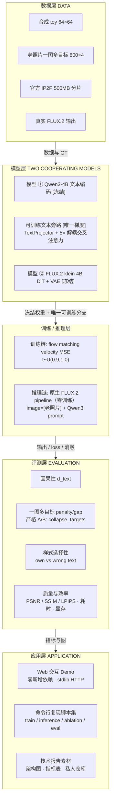
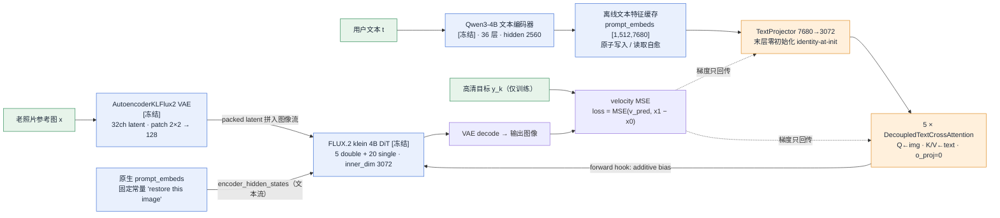
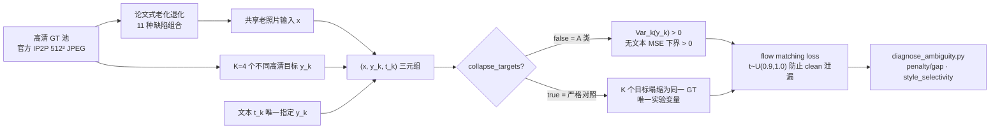
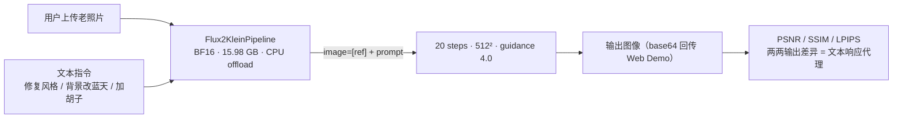

# 系统架构图

> **来源**：`AI系统实训_课程安排.pdf` 第 4 页「报告含系统架构图」要求。
> **整理日期**：2026-11-17
> **位图版**：[`results/figures/system_architecture.png`](../results/figures/system_architecture.png)（200 dpi，可直接插入技术报告 / PPT）
> **重绘命令**：`D:/Anaconda/envs/ChatAI/python.exe scripts/draw_system_architecture.py`
> **性质**：本图描述**仓库里真实存在的实现**，不是设想方案。带 `[FACT]` 的数字来自 `outputs/logs/backbone_inspect.json` 等实测日志。

---

## 1. 总体分层架构

---

## 2. 双模型协同与冻结边界（核心）

**关键契约 `[FACT]`**

| 项 | 值 | 来源 |
|---|---|---|
| DiT `in_channels` | 128（VAE 32ch × patch 2×2） | `backbone_inspect.json` |
| `inner_dim` | 3072 | 同上 |
| `joint_attention_dim` | 7680（Qwen3 `prompt_embeds`） | 同上 |
| double / single blocks | 5 / 20 | 同上 |
| 冻结主干参数量 | 3,959,590,691 | `src/condition/freeze.py` |
| double block 返回 | `(txt, img)` → hook 取 `img_index=1` | `pipeline_flux2_klein.py` 核实 |
| 编解码顺序 | encode: patchify → 反 BN → pack；decode: unpack → 乘 BN std + mean → unpatchify | `src/system.py` |

> **中心假设修正**：原 DeepSeek 方案假设「参考图特征占据了文本输入分支」。从 `diffusers 0.37.1` 源码核实，FLUX.2 的 `image=[ref]` 是 VAE 编码后 **concat 进图像流**，而 `encoder_hidden_states` 是独立的 Qwen3 文本流——**参考图没有占据文本流**。因此本项目的「新增文本旁路」是冻结主干上的额外条件通路，不是「夺回被占用的分支」。

---

## 3. 训练数据流（一图多目标可证伪实验）

---

## 4. 推理 / 演示数据流（原生 FLUX.2，零训练）

> **边界**：这条链用的是**原生模型能力**（冻结 Qwen3 + 冻结 DiT + 冻结 VAE，零训练），**不是**项目自训文本旁路的成果；写报告时必须分开陈述，不可用它证明一图多目标 verdict。

---

## 5. 评测链与代码对应

| 层 | 文件 |
|---|---|
| 数据层 | `src/data/dataset.py`, `old_photo.py`, `multi_target_dataset.py`, `ip2p_dataset.py`, `scripts/build_old_photo_multitarget.py`, `scripts/fetch_ip2p_shard.py` |
| 模型层（冻结） | `src/backends/flux2_klein.py`, `src/system.py`, `src/condition/freeze.py` |
| 模型层（可训练） | `src/condition/text_projector.py`, `bypass.py`, `module.py` |
| 训练 / 推理层 | `src/train.py`, `src/inference.py`, `scripts/run_flux2_old_photo_demo.py` |
| 评测层 | `scripts/verify_real_forward.py`, `diagnose_text_usage.py`, `diagnose_ambiguity.py`, `eval_restoration_quality.py` |
| 应用层 | `app/demo_server.py`, `scripts/draw_system_architecture.py`, `docs/` |

---

## 6. 图中不做的主张

- 不声称项目自训旁路已达到可用的老照片修复质量；最新 verdict 为 `NOT-YET-SUPPORTED`（32 组探针 `penalty/gap = 7.28% < 10%`）。
- 不声称原生 FLUX.2 出图等价于项目训练成果。
- 不声称已做人脸身份保持；项目名含「人脸」，但当前只是**老照片人像载体**。
- 不把 IP2P A 类的 `36.73%` 与老照片 A 类的 `7.28%` 混用。
